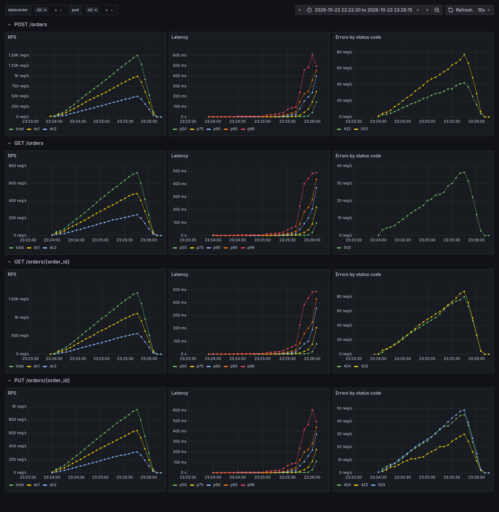

# HW1. Инструменты автоматизации в Grafana



## Запуск

```bash
cd ddia-hw-1
./scripts/init-secrets.sh
docker compose up --build -d
```

## Куда смотреть

- Дашборд: <http://localhost:3000/d/orders-service>. Логин `admin`, пароль в `secrets/grafana_admin_password.txt`.
- Ручки сервиса (Swagger): <http://localhost:8081/docs>, поды на портах 8081–8083.
- VictoriaMetrics: <http://localhost:8428/vmui>.

Нагрузка k6 стартует сама и останавливается при массовых таймаутах.
Перезапуск с чистыми метриками: `docker compose down -v && docker compose up --build -d`.
